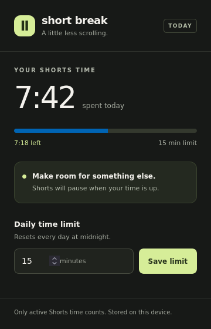
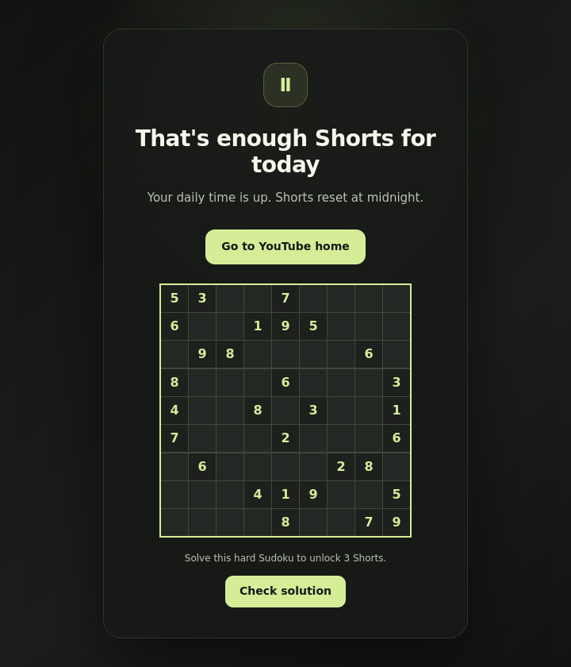

# Short Break

A Firefox and Zen extension that tracks time spent on YouTube Shorts and blocks the feed at your daily limit.



The popup rendered in Firefox with sample usage data.

## Install in Firefox or Zen

1. Download or clone this project.
2. Open `about:debugging#/runtime/this-firefox`.
3. Choose **Load Temporary Add-on** and select this project's `manifest.json`.
4. Reload any YouTube tabs that were already open.
5. Open Short Break from the browser's extensions menu to set your daily limit.

No build step or dependencies are required. The default limit is 15 minutes; choose any whole number from 1 to 1440 minutes.

Temporary installations last until you close the browser. A permanent installation in release Firefox requires Mozilla signing. See Mozilla's [temporary installation instructions](https://extensionworkshop.com/documentation/develop/temporary-installation-in-firefox/) and [signing overview](https://extensionworkshop.com/documentation/publish/signing-and-distribution-overview/). Zen uses [Firefox extensions](https://docs.zen-browser.app/user-manual/extensions).

For Chrome or Edge, run `npm run build`, enable Developer mode at `chrome://extensions` or `edge://extensions`, and use **Load unpacked** to select `dist/chromium`.

## How it works

The timer counts time on `/shorts` pages while the tab is visible and focused, including time spent reading comments or watching a paused Short. It shares one daily total across YouTube tabs and saves it locally. Reloading YouTube does not reset the total. A permanently installed extension also keeps it across browser restarts. Time resets at midnight using your computer's local time.

A badge on Shorts shows how much time remains. At the limit, the extension covers the feed, pauses videos, and blocks scrolling. The block screen offers a hard Sudoku and a link back to YouTube home. Regular YouTube videos remain available. Timing updates about once per second.

You can change the limit from the popup at any time. Raising it above today's usage makes Shorts available again. There is no reset button. Like other browser extensions, Short Break can be disabled or uninstalled by the browser's owner.

## Earn three more Shorts



The block screen rendered in Firefox with a sample puzzle.

Solve the Sudoku on the block screen to unlock three Shorts. Each generated puzzle has exactly one solution and cannot be completed using only naked or hidden singles. Fill all empty cells so every row, column, and 3 by 3 box contains the numbers 1 through 9.

The extension validates your solution in the background before granting the reward. The current Short uses the first credit; moving to another Short uses the next. You can finish the third Short, but opening a fourth blocks the feed again and offers a new puzzle. Revisiting a Short after leaving it also uses a credit. Refreshing the same Short does not. The allowance is shared across tabs and resets at midnight.

## Privacy and permissions

The extension uses the `storage` permission to keep your limit, daily total, current puzzle, and bonus allowance on this device. It stores the current bonus Short's ID to avoid charging twice for a refresh, and replaces that ID as you navigate. It runs a content script on YouTube pages to detect navigation into Shorts. It sends no analytics, watch history, or account information to a server.

The default manifest uses a Firefox background module. The Chromium build uses a service worker. Both save data with the WebExtensions storage API.

## Development

Use Node.js 22 or later to run the checks:

```sh
npm test
npm run check
npm run build
```

After editing files, click Reload for Short Break in `about:debugging` and reload YouTube. The build command copies the runtime files into `dist/firefox` and `dist/chromium`.

`icon.png` is the original artwork. To regenerate the extension icons and GitHub social-preview image, install ImageMagick 7 and run `bash scripts/generate-icons.sh`. The generated PNGs are checked in, so building the extension does not require ImageMagick. The repository's social-preview image is `docs/social-preview.png`; upload it under GitHub repository Settings → General → Social preview.

For a manual smoke test, set a one-minute limit and open a Short. Confirm the badge counts down, switch to another tab and confirm the total stops increasing, then return until the block appears. Try the mouse wheel, arrow keys, touch scrolling, and refreshing. Open another Shorts tab to confirm the shared block. Use the home link to confirm regular YouTube still works. Raise the limit in the popup and confirm Shorts becomes available again. Solve a Sudoku, watch three Shorts, and confirm the fourth is blocked. Try an incorrect solution and confirm it grants no credit.

The automated tests exercise timer logic and mocked browser behavior. They do not replace testing against YouTube in a browser with the extension installed.

## CI and releases

GitHub Actions runs tests, syntax checks, Firefox extension validation, and packaging on every push and pull request. Download the Firefox and Chromium packages from the completed CI run's artifacts.

To publish a release, update the version in both manifests and `package.json`, commit the change, and push a matching version tag:

```sh
git tag v1.0.0
git push origin v1.0.0
```

The release workflow validates the code and publishes both browser ZIPs on GitHub Releases. The Firefox package is unsigned. Use temporary installation for testing, or submit it to Mozilla for signing before permanent installation. The workflow does not publish to browser add-on stores.
